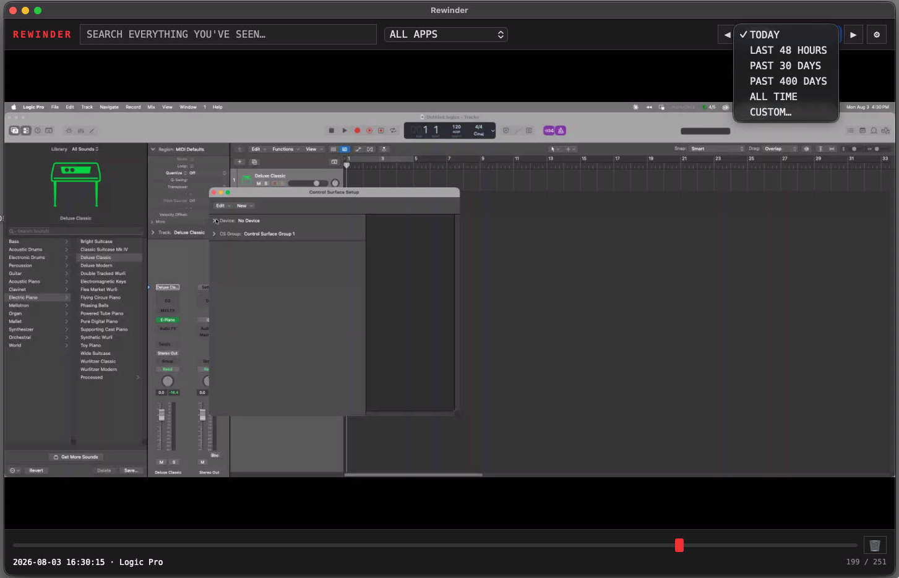
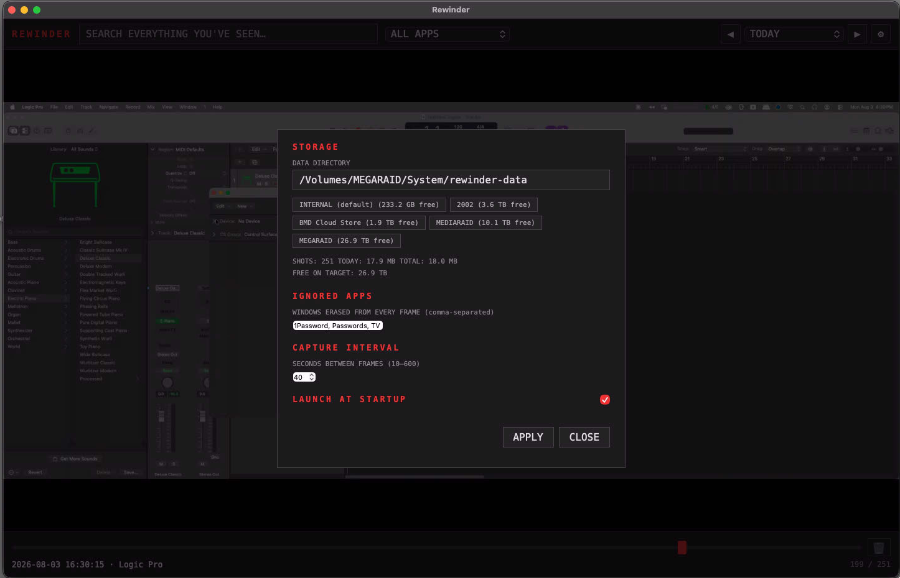
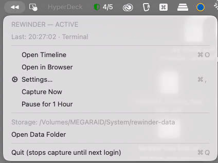

# Rewinder

A private, searchable visual history of everything you've seen on your Mac.
Rewinder quietly captures the active screen, OCRs every frame on-device with Apple's built-in engine.
Nothing leaves your computer. Ever. It's all locally processed and stored. No AI, No LLM, No training, nothing.



## Download

**[⬇ Get the latest Rewinder DMG](../../releases/latest)** — open it, drag
Rewinder into Applications, launch, and click **Allow** on the Screen
Recording prompt. That's the whole install.

Apple Silicon, macOS 14+. Signed and notarized — no Gatekeeper hoops.

## Features

- **Menu-bar app** — ◀◀ when active, ◁◁ when not; pause, capture-now, and
  settings from the dropdown
- **DRM-safe** — captures (like Cmd-Shift-3) never
  interrupts protected playback; DRM video just appears black in frames
- **Full-text search** of everything ever on screen (SQLite FTS5, on-device)
- **Timeline scrubbing** across ranges: today / 48 h / 30 d / 400 d / all
  time / custom date span — drags stay live at any speed: a 320 px proxy of
  each frame paints while you move, the full frame lands the moment you stop
- **Per-app filter** — every frame is tagged with the frontmost app
- **Ignored apps** — Privacy first. Listed apps' windows are *excluded from the frame itself*
- **Encrypted at rest** — every frame and its OCR text is sealed with
  AES-256; the key lives in your login Keychain. Optionally require Touch ID
  or your password to open the timeline
- **Idle dedup** — near-identical consecutive frames are skipped before OCR;
- **Tiny frames** — ~50 KB/frame, roughly 50–90 MB per working day
- **Storage manager** — point it at any volume; background migration, and a
  local spool if the volume is unmounted
- **Delete** — single frame, last hour, today, today+yesterday, or
  everything

## Screenshots

| Settings | Menu bar |
| --- | --- |
|  |  |

## Encryption

Frames are unreadable off your Mac — copy the data folder to another
machine and you get ciphertext. The key is created automatically on first
launch and stored in your login Keychain, where only Rewinder can use it.

**Back up your key** (menu bar → *Export Encryption Key…*) and keep the
file somewhere safe. If your Mac dies and you restore the data folder to a
new one, *Import Encryption Key…* brings your history back. Without the
key, encrypted history is unrecoverable — by design.

Turn on **Require unlock to view** in Settings and the timeline stays
locked behind Touch ID or your account password until you authenticate.
Capture keeps running either way.

## Build from source

```sh
./build.sh            # compiles, assembles, and signs /Applications/Rewinder.app
```

Signing uses a certificate named in `build.sh`; adjust `CERT` to your own
identity. A stable signing identity is what keeps macOS permission grants
(Screen Recording etc.) across rebuilds.

## Architecture

- `app/main.swift` — menu-bar host: in-process capture (ScreenCaptureKit
  one-shot + Vision OCR + dedup fingerprint), settings sync, native WKWebView
  timeline window, launchd agent self-install
- `app/Server.swift` — embedded server on localhost:8787; indexes OCR
  sidecars into SQLite FTS5 and serves the UI + JSON API (in-process)
- `app/Crypto.swift` — AES-256-GCM sealing of stored files, Keychain key
  management, and the unlock-to-view gate (LocalAuthentication)
- `app/Thumbs.swift` — the scrub proxies: a 320 px JPEG per frame, sealed
  with the frame key, cached under `~/rewinder/thumbs.noindex` (a derived
  cache, safe to delete — it rebuilds in the background)
- `ui/index.html` — the timeline/search UI (vanilla JS, no dependencies)
- Frames live as `YYYY-MM-DD/HHMMSS.webp` + `.txt` (OCR) + `.json` (app tag)
  sidecars, each encrypted at rest; the search index can always be rebuilt
  from the sidecars
